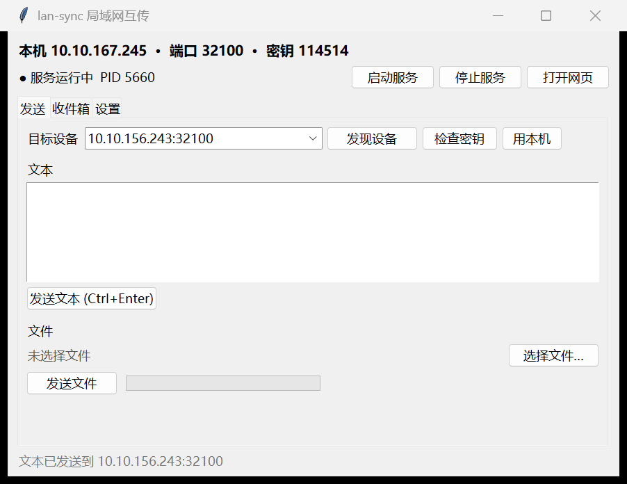

# lan-sync · 局域网双机互传

纯 Python 标准库实现的点对点传输工具：**文本 + 文件**，零第三方依赖，不走任何云服务，数据只在你自己的局域网里流动。



## 特性

- **双端互传**：同一局域网内的两台电脑互发文本、文件、整个目录
- **图形界面**（Tkinter）：打开即自动启动接收服务，发送 / 接收 / 配对全用鼠标完成
- **网页接收端**：手机或任意设备浏览器直接上传下载
- **自动发现**：三路并行——UDP 广播 + 历史设备单播（跨子网可用）+ 本网段扫描，广播被屏蔽也能找到
- **密钥自检**：`check` 一条命令判断目标在线状态与密钥是否匹配
- **配对密钥**：两台设备需要同一密钥才能收发，界面可一键复制/随机生成
- **安全落盘**：同名文件自动加 `(1)` 后缀，不覆盖
- **零依赖**：单文件、纯标准库；Windows 提供 PyInstaller 单文件 exe（对端免装 Python）
- **跨平台**：CLI 与 GUI 支持 Windows / Linux / macOS；exe 仅 Windows

## 快速开始

### Windows：免安装 exe

双击 `scripts/lan-sync-gui.exe`，会自动在后台启动接收服务：

- **发送页**：点「发现设备」自动列出局域网内机器 → 选目标 → 发文本或文件（可多选，带进度条）
- **收件箱页**：自动刷新收到的内容，双击文件直接打开，双击文本复制到剪贴板
- **设置页**：改端口、设备名、配对密钥（改密钥会自动重启服务生效）

命令行方式：

```powershell
scripts\lansync.exe info
scripts\lansync.exe serve --background
scripts\lansync.exe send --target 192.168.1.7 --text "你好"
scripts\lansync.exe send --target 192.168.1.7 --file "D:\报告.pdf"
scripts\lansync.exe inbox
scripts\lansync.exe pair --key 1234abcd
scripts\lansync.exe stop
```

### 任意平台：源码运行

需要 Python 3.8+（GUI 需要 tkinter，Windows 官方安装包自带）：

```bash
python scripts/lansync.py gui
python scripts/lansync.py serve --background
```

## 常用命令

| 命令 | 作用 |
|---|---|
| `gui` | 打开图形界面 |
| `info` | 本机 IP / 端口 / 密钥 / 服务状态 |
| `serve [--background]` | 启动接收服务 |
| `status` | JSON 格式服务状态 |
| `stop` | 停止后台服务 |
| `discover [--no-scan]` | 三路发现：广播 / 历史设备 / 扫描本网段 |
| `check --target IP` | 判断目标是否在线、密钥是否匹配 |
| `key [--new]` | 查看当前密钥 / 随机换新并重启服务 |
| `send --target IP[:端口] --text ...` | 发送文本 |
| `send --target IP[:端口] --file ...` | 发送文件 / 目录（可多个） |
| `inbox [--limit N]` | 查看收件箱 |
| `pair --key KEY` | 设置配对密钥（自动重启服务） |
| `firewall` | 打印 Windows 防火墙放行命令 |

## 网页接收端

接收方启动服务后，局域网内任意设备浏览器打开：

```
http://<接收方IP>:32100/?key=<配对密钥>
```

可直接上传文件、发文本、下载收件箱内容，适合手机传东西到电脑。

## 数据目录

默认 `%USERPROFILE%\.marvis-lan-sync\`（Linux / macOS 为 `~/.marvis-lan-sync/`）：

```
config.json          设备名 / 端口 / 配对密钥
state.json           运行状态
server.log           服务日志
inbox/messages.jsonl 收到的文本记录
inbox/files/         收到的文件
```

可用环境变量 `LAN_SYNC_HOME` 覆盖，便于同一台机器跑多个实例做测试。

## 网络与端口

- TCP `32100`：文件 / 文本传输（网页 UI 同端口）
- UDP `32101`：设备自动发现
- Windows 首次使用若对端连不上，按 `firewall` 输出的命令放行（需管理员 PowerShell）

## 构建 exe（可选）

```powershell
pip install pyinstaller
# 命令行版
pyinstaller --onefile --name lansync scripts/lansync.py
# 窗口版（GUI）
pyinstaller --onefile --windowed --name lan-sync-gui --paths scripts scripts/lansync_gui.pyw
```

## 安全说明

- 只建议在**可信局域网**内使用；服务监听 `0.0.0.0`，请勿暴露到公网
- 配对密钥用于拦截同网段其他设备的误发，**不是加密传输**；敏感数据请自行评估
- 密钥可随时用 `pair --key <新密钥>` 更换
- 收件箱文件保存在本机数据目录，不再经过任何第三方

## 目录结构

```
scripts/   程序源码与打包好的 exe
docs/      完整使用说明（usage.md）与界面截图
```

完整使用说明（含排障对照表）见 [docs/usage.md](docs/usage.md)。
